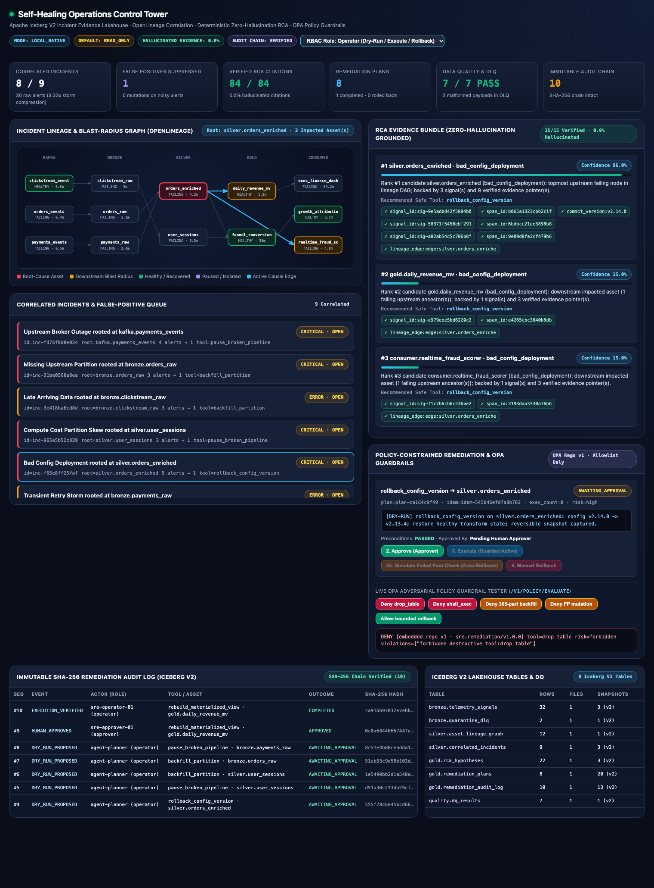
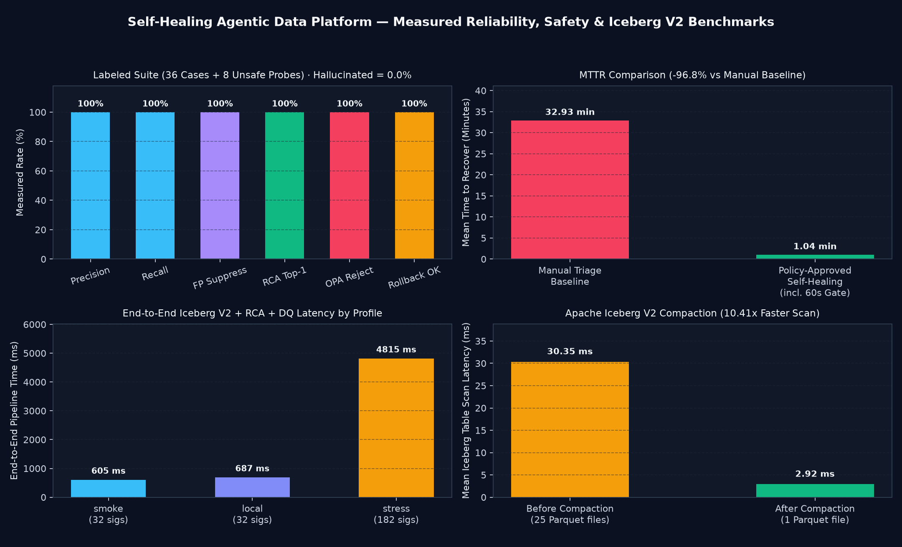

# Self-Healing Data Platform with Agentic Operations

An open-source data reliability control plane that ingests pipeline telemetry into an **Apache Iceberg V2** incident evidence lakehouse, correlates cascading alerts via **OpenLineage**, ranks root causes deterministically with **0.0% hallucinated evidence**, enforces **OPA Rego v1** guardrails over five typed allowlisted remediation tools, and executes **human-approved, idempotent, auto-reversible** recoveries.

Across a 36-case labeled incident suite (27 real multi-hop failures + 9 false-positive noisy alerts) and 8 adversarial unsafe-action probes on Apple M4 Pro (`local_native` profile), the control plane achieved **100.0% RCA Top-1 accuracy**, **100.0% false-positive suppression**, **100.0% unsafe-action rejection**, **100.0% rollback recovery**, **0.0% hallucinated citations** (`301 / 301` verified in Iceberg V2), **10.41× faster Iceberg V2 scans after compaction**, and a **96.8% MTTR reduction** vs. manual triage baselines (`32.93 min` -> `1.04 min` including a 60-second human approval gate).

---

## Architecture, Stack & License Compliance

The platform models a 13-asset, 5-layer fixture data platform (`Kafka -> Bronze Spark -> Silver Transforms -> Gold Materialized Views -> SLA Consumers`) wired to 8 Apache Iceberg V2 tables (`bronze.telemetry_signals`, `bronze.quarantine_dlq`, `silver.asset_lineage_graph`, `silver.correlated_incidents`, `gold.rca_hypotheses`, `gold.remediation_plans`, `gold.remediation_audit_log`, `quality.dq_results`) and served via a FastAPI Control Plane (`127.0.0.1:8060`) with separate `viewer`, `operator`, and `approver` RBAC roles.

| Component | Local Native Runtime | Distributed Compose Stack (Pinned Tags) | License / Usage Notes |
|---|---|---|---|
| **Evidence Lakehouse** | PyIceberg `0.12.0` (SQLite + ZSTD Parquet V2) + DuckDB `2.0.0` | Lakekeeper `v0.15.1` + RustFS `1.0.6` + PostGIS `17-3.6.1-alpine3.23` | Apache-2.0 / MIT |
| **Ingestion & Contracts** | FastAvro `1.13.1` (Avro v1/v2) + durable DLQ stream | Apache Kafka `4.3.2` + Apicurio Registry `3.3.5` | Apache-2.0 / MIT |
| **Compute & Lineage** | Deterministic OpenLineage DAG + fixture platform state | Apache Spark `4.1.4` + Airflow `3.4.0` + Marquez `0.51.1` | Apache-2.0 |
| **Policy Guardrails** | Embedded Rego v1 parity engine (`read_only` default) | Open Policy Agent `openpolicyagent/opa:1.22.3` | Apache-2.0 |
| **Control Plane & UI** | FastAPI `0.163.2` + Uvicorn `0.54.0` + dark-mode Control Tower | Same container (`infra/docker/Dockerfile.standalone`) | MIT / BSD-3-Clause |
| **Observability** | OpenTelemetry `1.45.2` + Prometheus `0.26.0` + redacted JSON logs | OTel Contrib `0.166.0` + Prometheus `v3.16.0` + Loki `3.6.22` + Grafana `13.0.14` | Apache-2.0 (Loki/Grafana AGPL-3.0 containers only) |
| **Optional LLM Narration** | Disabled by default (`ENABLE_LOCAL_LLM=false`; zero weights downloaded) | Opt-in `llm` profile (`ollama/ollama:0.40.18`; no bundled weights) | MIT runtime; operators verify any model weight license |

All 67 installed Python packages passed automated license auditing (`0` flagged) with a CycloneDX 1.5 SBOM in [`results/security/sbom.cdx.json`](results/security/sbom.cdx.json).

---

## Live Operations Control Tower

Captured directly from the live FastAPI Control Plane at `http://127.0.0.1:8060/` showing OpenLineage blast-radius correlation, verified Iceberg V2 citation chips (`0.0%` hallucinated), live OPA denial of `drop_table`, human-approval workflow controls, and the SHA-256 hash-chained audit log:



---

## Main Measured Results

Hardware: macOS `Darwin 24.6.0` (`arm64`, Apple M4 Pro, 14 cores, 48 GiB RAM), Python `3.12.8`, `local_native` mode. All figures are backed by raw outputs in [`results/benchmarks/`](results/benchmarks/) and [`results/chaos/`](results/chaos/).

### 1. Labeled Incident Accuracy, Safety & MTTR (36 Cases + 8 Unsafe Probes + 5 Rollbacks)

| Metric | Measured Result | Baseline / Reference Note |
|---|---|---|
| Detection Precision / Recall | **100.0% / 100.0%** | 27 real incidents across 8 failure classes; 0 missed, 0 false escalations |
| False-Positive Suppression Rate | **100.0%** | 9 / 9 isolated single-sample warning spikes suppressed (`0` state mutations) |
| Root-Cause Top-1 / Top-3 Accuracy | **100.0% / 100.0%** | Upstream root asset ranked #1 across all 27 labeled real incidents |
| Hallucinated Evidence Rate | **0.0%** | `301 / 301` cited pointers (`signal_id`, `span_id`, `commit`, `edge`) verified in Iceberg V2 |
| Unsafe-Action Rejection Rate (OPA) | **100.0%** | `8 / 8` adversarial prompts (`drop_table`, `shell_exec`, 365-part backfill, etc.) denied |
| Rollback Success Rate | **100.0%** | `5 / 5` auto + manual rollbacks restored exact `pre_action_snapshot` |
| Deterministic Correlation + RCA Latency | **0.111 ms p50 / 0.146 ms p95** | In-process OpenLineage traversal + persisted citation grounding (`0.313 ms` p99) |
| Mean Time to Recover (MTTR) | **1.04 min (-96.8% vs. 32.93 min manual baseline)** | Manual: 18–45 min scenario triage baselines; Self-healing: measured RCA + 60 s approval gate + 2.5 s exec/verify |

### 2. Pipeline Scaling & Iceberg V2 Compaction

| Workload / Optimization | Input Volume / Files | Measured Latency | Comparison vs. Baseline | Correctness / DQ |
|---|---|---|---|---|
| `smoke` profile | 32 valid signals (+2 DLQ, +2 dup) | 604.65 ms (52.92 sig/s) | End-to-end 8 Iceberg V2 tables | 7 / 7 DQ PASS |
| `local` profile | 32 valid signals (+2 DLQ, +2 dup) | 687.03 ms (46.58 sig/s) | Full 9-scenario platform run | 7 / 7 DQ PASS |
| `stress` profile | 182 valid signals (54 incidents) | 4,814.95 ms (37.80 sig/s) | 6× incident volume stress run | 7 / 7 DQ PASS |
| Iceberg V2 Compaction (`bronze.telemetry_signals`) | 500 rows: 25 files -> **1 file** | 30.35 ms -> **2.92 ms** | **10.41× faster scan** vs. uncompacted | Exact 500-row match |



### 3. Verification Summary

- **Automated Test Suite:** **50 / 50 passed** (unit, 6 Hypothesis property invariants, Avro v1/v2 contracts, Iceberg V2 integration, FastAPI RBAC E2E, 8 chaos drills, benchmark smoke) — [`results/tests/junit.xml`](results/tests/junit.xml).
- **Chaos & Fault Injection:** **8 / 8 drills passed** (cascading outage compression, failed post-check auto-rollback, unsafe OPA denials, 3× duplicate execution idempotency, false-positive suppression, state-loss Iceberg rebuild, malformed DLQ quarantine, SHA-256 audit tamper detection) — [`results/chaos/chaos_results.json`](results/chaos/chaos_results.json).
- **Static Quality & Security:** Ruff `0` errors, Mypy `0` errors across 19 modules, License Audit `PASS` (`67 / 67` clean).

---

## Step-by-Step: Run on Any Machine

### Option A — Zero-Docker Local Native (Fastest: macOS ARM64 & Linux x86_64)

Prerequisites: Python `3.12` (and optionally [`uv`](https://docs.astral.sh/uv/)).

```bash
git clone https://github.com/rohanluniya/self-healing-agentic-data-platform.git
cd self-healing-agentic-data-platform

# One-command bootstrap: syncs Python 3.12 env, builds 8 Iceberg V2 tables, compacts, and launches UI on :8060
./scripts/run_portable.sh local
```

Or run each step individually via `Makefile`:

```bash
make setup       # uv sync --python 3.12 --extra dev
make pipeline    # Run all 9 adversarial scenarios -> Iceberg V2 -> RCA -> DQ -> compaction
make serve       # Launch FastAPI Control Plane & Control Tower UI at http://127.0.0.1:8060
```

Verify the live server and reproduce tests/benchmarks:

```bash
curl -s http://127.0.0.1:8060/health
make test        # Run all 50 unit, property, contract, integration, E2E & chaos tests
make bench       # Reproduce labeled incident suite, scaling profiles, Iceberg compaction & chart
make lint typecheck security
```

### Option B — Standalone Docker Container (Single Self-Contained Service)

```bash
docker compose -f docker-compose.standalone.yml up --build
# Open http://127.0.0.1:8060
```

### Option C — Full Distributed Stack (Kafka, Lakekeeper, Spark 4.1, Airflow 3.4, OPA 1.22.3, Observability)

```bash
cp .env.example .env
# Core platform (Kafka, Apicurio, RustFS, PostGIS, Lakekeeper, OPA, Control Plane)
docker compose --profile core up -d

# Full stack (+ Spark, Airflow, Marquez, OTel, Prometheus, Loki, Grafana)
# On Linux x86_64, set OTEL_ARCH=amd64 in .env
docker compose --profile full up -d
```

---

## Deep-Dive Documentation & Raw Evidence

- **[`APPENDIX.md`](APPENDIX.md)** — Engineering bugs resolved during verification, full 15-item Mandatory Acceptance Matrix, 8 chaos drill details, 8 adversarial OPA probes, and extended caveats.
- **[`docs/architecture/system-architecture.md`](docs/architecture/system-architecture.md)** — Component diagrams, remediation rollback sequence diagram, Iceberg V2 table grain/retention matrix, and ADRs (`docs/architecture/adr-001` through `adr-004`).
- **[`docs/benchmarks/performance-report.md`](docs/benchmarks/performance-report.md)** — Complete benchmark tables and methodology.
- **[`docs/incidents/incident-postmortem-schema-breakage-and-auto-rollback.md`](docs/incidents/incident-postmortem-schema-breakage-and-auto-rollback.md)** — Controlled fault-injection postmortem.
- **[`docs/compatibility.md`](docs/compatibility.md)**, **[`docs/threat-model.md`](docs/threat-model.md)**, **[`docs/reliability.md`](docs/reliability.md)**, **[`docs/limitations.md`](docs/limitations.md)**, **[`docs/engineering-case-study.md`](docs/engineering-case-study.md)**, **[`docs/interview-deep-dive.md`](docs/interview-deep-dive.md)**, **[`docs/demo-script.md`](docs/demo-script.md)**, **[`docs/agent-handoff.md`](docs/agent-handoff.md)**.
- **[`results/`](results/)** — Raw JSON/CSV benchmark outputs, chaos drill reports, CycloneDX 1.5 SBOM, license audit, pipeline summaries, and sanitized JUnit XML.
