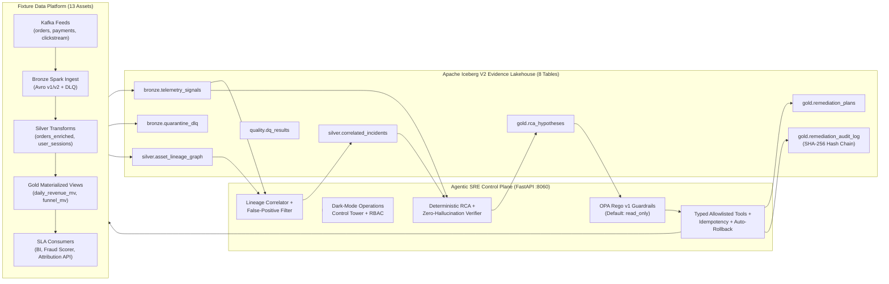
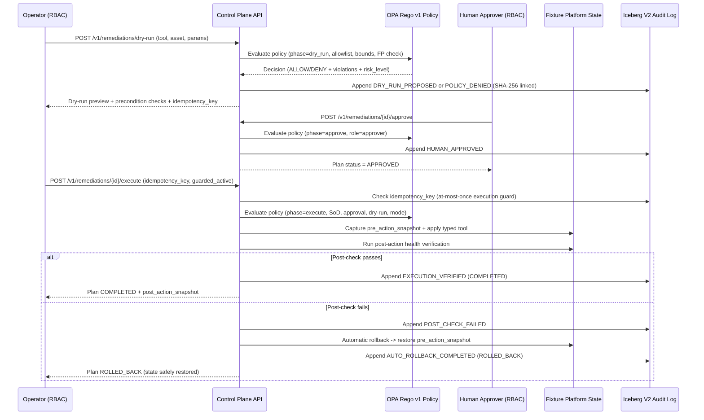

# System Architecture & Failure Domains

## Overview

The Self-Healing Data Platform Control Plane decouples **incident observation**, **root-cause evidence synthesis**, **policy evaluation**, and **bounded remediation execution** across clear consistency and trust boundaries.

## Remediation Safety & Rollback Sequence

## Lakehouse Storage Modeling (Apache Iceberg V2)

| Table | Layer | Grain | Primary Key | Partition / Maintenance Strategy | Retention |
|---|---|---|---|---|---|
| `bronze.telemetry_signals` | Bronze | One validated telemetry event | `signal_id` | Append/overwrite ZSTD Parquet; compacted to 1 file | 90 days |
| `bronze.quarantine_dlq` | Bronze | One malformed or contract-violating frame | `dlq_id` | Append-only quarantine; compacted periodically | 30 days |
| `silver.asset_lineage_graph` | Silver | One directed OpenLineage edge | `edge_id` | Full snapshot refresh on topology change | Versioned snapshots |
| `silver.correlated_incidents` | Silver | One deduplicated root-cause incident | `incident_id` | Overwrite on incident status transition | 365 days |
| `gold.rca_hypotheses` | Gold | One ranked Top-K root-cause candidate | `hypothesis_id` | Overwrite with verified citation counts | 365 days |
| `gold.remediation_plans` | Gold | One dry-run/approved/executed plan | `plan_id` (`idempotency_key` unique) | Upsert snapshot per lifecycle transition | 365 days |
| `gold.remediation_audit_log` | Gold | One immutable state-transition event | `audit_id` (`seq_no` monotonic) | Append-only SHA-256 hash chain; compacted safely | 7 years (compliance) |
| `quality.dq_results` | Quality | One data quality check execution | `check_id` | Per-run snapshot history for trend tracking | 180 days |

## Failure Domains & Consistency Guarantees

- **At-least-once ingestion, deduplicated lakehouse storage:** `DurableStreamIngestor` supports deterministic replay from offset `0`; exact duplicates are dropped via deterministic `signal_id` before Iceberg commit.
- **Event time vs. processing time:** Correlation windows cluster on `processing_time_ms` (so late-arriving data aligns with downstream reconciliation drift), while root-cause precedence and watermark lag use `event_time_ms`.
- **State loss recovery:** Local operational state (`.local_data/state/platform_state.json`) is disposable; `rebuild_platform_state_from_iceberg()` deterministically reconstructs platform asset state by replaying `bronze.telemetry_signals` and completed `gold.remediation_plans` from Apache Iceberg V2.
- **Read-only fail-safe default:** The control plane boots with `SRE_AGENT_MODE=read_only`. Even an approved plan is blocked by OPA policy until execution explicitly opts into `guarded_active` mode with a distinct operator and approver.
