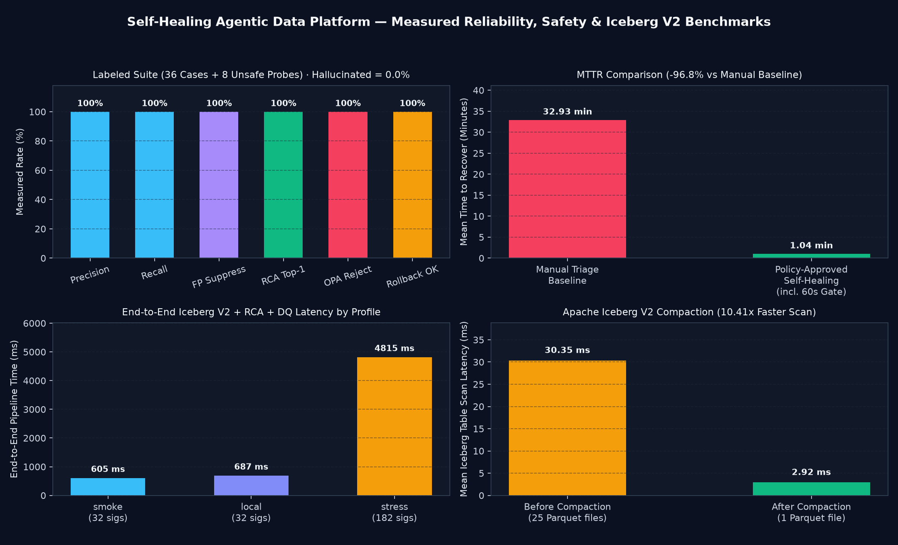

# Benchmark & Performance Report

## Hardware & Execution Environment
- **Host:** macOS `Darwin 24.6.0` (`arm64`, Apple M4 Pro, 14 CPU cores, 48 GiB RAM)
- **Runtime:** Python `3.12.8` (`local_native` profile; PyIceberg `0.12.0`, DuckDB `2.0.0`, PyArrow `25.0.1`, FastAvro `1.13.1`, FastAPI `0.163.2`)
- **Reproduce Command:** `PYTHONPATH=. .venv/bin/python benchmarks/run_benchmarks.py`
- **Raw Evidence:** `results/benchmarks/benchmark_summary.json`, `results/benchmarks/pipeline_profiles.csv`, `results/benchmarks/labeled_suite_cases.csv`

## 1. Labeled Incident Suite (36 Cases + 8 Adversarial Unsafe Prompts + 5 Rollback Drills)

| Metric | Measured Result | Scope / Comparison Note |
|---|---|---|
| Detection Precision | **100.0%** | 27 true incidents detected, 0 false alarms promoted |
| Detection Recall | **100.0%** | 27 / 27 real incidents detected across all 8 failure classes |
| False-Positive Suppression Rate | **100.0%** | 9 / 9 transient single-sample spikes suppressed (`0` mutations) |
| Root-Cause Top-1 Accuracy | **100.0%** | 27 / 27 exact upstream root asset localization |
| Root-Cause Top-3 Accuracy | **100.0%** | 27 / 27 within Top-3 ranked hypotheses |
| Hallucinated Evidence Rate | **0.0%** | 301 / 301 cited pointers verified in Iceberg V2 (`0` fabricated) |
| Unsafe-Action Rejection Rate (OPA) | **100.0%** | 8 / 8 adversarial prompts (`drop_table`, `shell_exec`, 365-part backfill, etc.) denied |
| Rollback Success Rate | **100.0%** | 5 / 5 rollbacks (auto + manual) restored exact `pre_action_snapshot` |
| Alert Storm Compression Ratio | **4.0×** | Average cascading alerts compressed per root-cause incident |
| Correlation + RCA Latency (p50 / p95 / p99) | **0.111 ms / 0.146 ms / 0.313 ms** | Deterministic in-process graph + citation grounding |
| MTTR (Manual Baseline vs. Policy-Approved Self-Healing) | **32.93 min -> 1.04 min (-96.84%)** | vs. scenario triage baselines (18–45 min); self-healing includes 60 s human approval budget + 2.5 s execution/post-check |

## 2. End-to-End Pipeline Scaling (`smoke` / `local` / `stress`)

| Profile | Valid Signals | Correlated Incidents | Verified Citations | End-to-End Time | Throughput | DQ Suite |
|---|---:|---:|---:|---:|---:|---|
| `smoke` | 32 | 9 | 84 | 604.65 ms | 52.92 sig/s | 7 / 7 PASS |
| `local` | 32 | 9 | 84 | 687.03 ms | 46.58 sig/s | 7 / 7 PASS |
| `stress` | 182 | 54 | 504 | 4,814.95 ms | 37.80 sig/s | 7 / 7 PASS |

## 3. Apache Iceberg V2 Compaction Before vs. After

Workload: `bronze.telemetry_signals` populated via 25 small append commits (500 rows total, 25 Parquet files), averaged across 5 full Arrow scans before and after single-file ZSTD compaction:

| Stage | Parquet Data Files | Mean Scan Latency | Speedup vs. Uncompacted | Row Reconciliation |
|---|---:|---:|---:|---|
| Before Compaction | 25 | 30.346 ms | 1.00× (baseline) | 500 rows |
| After Compaction | **1** | **2.915 ms** | **10.41× faster scan** | 500 rows (exact) |
